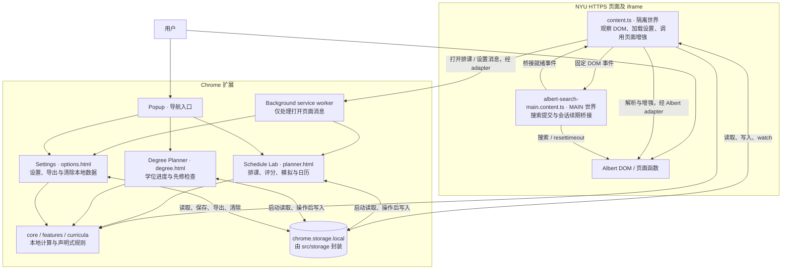
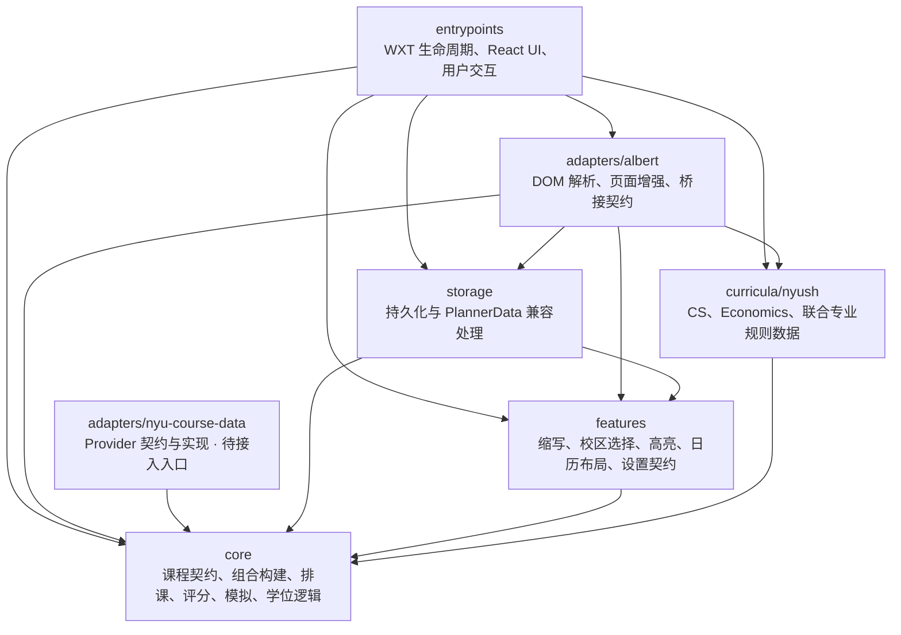
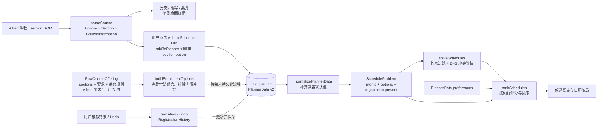

# Albert Enhancer 架构

本文件是项目架构入口，描述当前源码中的职责、依赖和运行流程。图使用可随代码维护的 Mermaid；除明确标为「待接入」或「建议」的内容外，均对应现有实现。

阅读顺序：本文件 → 相关模块 README → 公共接口 → 对应测试。排课组合规则见 [Schedule architecture](SCHEDULE_ARCHITECTURE.md)，权限和数据政策见 [Privacy](PRIVACY.md)。

## 1. 系统与运行边界

项目使用 TypeScript、WXT 和 React，构建为 Chrome Manifest V3 扩展。当前没有自建后端；计算在内容脚本或扩展页面中完成，后台只负责打开页面。

以下箭头表示运行时交互，允许请求、响应和存储通知形成回路，**不代表代码导入关系**。

- 两个内容脚本均匹配 `https://*.nyu.edu/*`，启用 `allFrames`。匹配范围比 Albert 页面广；具体增强由选择器和页面内容判断。
- `content.ts` 监听 DOM 变化和设置、排课存储变化；React 页面当前只在启动时读取存储，在本页操作后更新状态并写入，没有跨页面 `watch`。
- MAIN 世界脚本调用 Albert 的 `submitAction_win0` 搜索函数，以及经过 URL 校验的会话续期流程。它不读取扩展存储。
- 排课状态中的 `got-it`、`full`、`waitlisted` 是本地模拟事件，不向 Albert 提交注册操作。

## 2. 模块依赖与职责

以下箭头统一表示 **A 导入 B**，包含类型依赖；省略模块内部连线和外部库。`core` 的细粒度依赖见 [core README](../src/core/README.md)。

| 模块 / 入口 | 责任与公共接口 | 直接依赖及验证位置 |
| --- | --- | --- |
| `entrypoints/` | `content.ts` 编排注入；MAIN 脚本桥接；`background.ts` 导航；`popup/`、`options/`、`planner/`、`degree/` 提供界面 | 上图中的应用模块、WXT、React；`tests/e2e/extension.spec.ts` |
| `adapters/albert/` | `parseCourse`、`enhanceAlbertPage`、校区/学期适配、脱敏 fixture、续期与事件常量；详见 [模块说明](../src/adapters/albert/README.md) | core、features、curricula、storage；`tests/adapters/`、E2E |
| `adapters/nyu-course-data/` | `CourseDataProvider`：`searchCourses`、`getCourse`、`getEnrollmentOptions`；`NYUCourseDataProvider` 注入 `NYUDataTransport`，解码外部数据；Mock 用于测试 | core 课程契约；`tests/adapters/courseDataProvider.test.ts` |
| `core/` | 平台无关领域契约与纯计算；按 courses、schedule、registration、curriculum 分区；详见 [模块说明](../src/core/README.md) | 仅 core 内部；`tests/courses/`、`schedule/`、`registration/`、`curriculum/` |
| `features/` | `expandAbbreviations` / `resolveAbbreviationQuery`、`selectPreferredCampus`、`buildHighlights`、日历布局及 `AlbertEnhancerSettings` 默认值 | core 类型、features 内部设置契约；`tests/features/` |
| `curricula/nyush/` | 声明式学位要求、分类数据、CS 先修规则；联合专业组合 CS 与 Economics 数据 | core/curriculum 契约、同层专业数据；`tests/curriculum/` |
| `storage/` | 四个存储 item；`normalizePlannerData`、`removeCourseFromPlanner`；`exportLocalData`、`deleteAllLocalData` | WXT storage、core、features；`tests/storage/planner.test.ts`、E2E |

有 `index.ts` 的模块以它作为公共入口；`storage` 按领域文件暴露接口。Albert 的 `searchBridge.ts` 是显式共享契约，MAIN 世界另直接导入 `sessionKeeper.ts` 的校验函数。不要通过总出口引入不需要的宿主依赖。

### 依赖约束

1. core 不得依赖 DOM、浏览器 API、React、WXT、adapters、features、storage 或 entrypoints。
2. features 和 curricula 不得反向依赖它们的宿主 adapter、UI 或 storage；storage 不得依赖使用它的 adapter 或 entrypoint。
3. Albert 选择器、页面解析与增强归 `adapters/albert`；entrypoints 只承担宿主生命周期与桥接调用。当前 MAIN 脚本保留少量页面函数访问，属于现存边界例外。
4. 文件导入必须无环；新增跨模块依赖也必须检查模块层面的方向，不能仅以「没有运行时循环」为依据。
5. `EnrollmentOption` 是 solver 的原子选择；讲座、习题课与实验课之间的组合规则由 builder 负责，不能渗入 solver。

当前上图列出的顶层模块依赖无环。core 内部存在 `courses` 与 `schedule` 目录间的双向依赖，虽然文件图无环，仍是待修正的模块边界问题，见第 5 节。

## 3. 排课数据流

以下箭头表示数据转换，不表示导入方向。实线为当前 Albert → Schedule Lab 流程；虚线为已有 builder 能力的待接入路径。

关键契约：

- `Section` 是真实课程组件；`EnrollmentOption` 是一门课的一套完整可选组合，包含 `sectionIds`、合并后的会议和可选展示元数据。
- builder 对未知多组件兼容关系返回空集合，避免生成未经确认的组合；当前 Albert 导入路径却直接把单个 section 当作 option，不能据此宣称已验证完整的多组件组合。
- `CourseIntent` 表达课程是否必选、可选 option 范围、section 要求/排除/偏好。精确 option 锁定与 section 锁定语义不同。
- `RegistrationHistory` 包含 `present` 和 `past`。状态转换和撤销都产生新值；solver 只接收 `present`。
- 可行性由 solver 决定，偏好由 ranking 决定；评分不改变可行性。`bruteForceSchedules` 是性质测试中的对照实现，没有运行入口调用。

学位规划是另一条独立流程：`DegreePlanEntry[]` + 所选 `curricula/nyush` 数据 → `evaluateCurriculum` / `dependencyWarnings` → 学位覆盖情况与先修提示 → `local:degree-plan`。目前它与排课数据没有自动同步。

## 4. 本地状态与平台接口

| 存储键 | 所有者 / 契约 | 当前读写方 |
| --- | --- | --- |
| `local:settings` | `storage/settings.ts` / `AlbertEnhancerSettings` | Settings 保存；content 读取并 watch |
| `local:planner` | `storage/planner.ts` / `PlannerData` v2 | Albert adapter 添加；Schedule Lab 读取与更新；content watch 后刷新增强 |
| `local:campus-options` | `storage/campuses.ts` / `CampusOption[]` | content 学习并保存；Settings 启动读取 |
| `local:degree-plan` | `storage/degreePlan.ts` / `DegreePlanEntry[]` | Degree Planner 启动读取与更新 |

`PlannerData` 的纯数据兼容与删除逻辑位于 `storage/plannerData.ts`，不导入 WXT；`planner.ts` 负责持久化绑定。兼容处理保留旧 option ID，补齐 section 状态、intent 和偏好默认值。

`exportLocalData` 聚合四个 item；`deleteAllLocalData` 清除扩展的整个 local 存储区域。存储读写目前没有事务或并发合并机制。

平台接口只有三类：

- 浏览器 runtime 消息 `open-schedule-lab`、`open-settings`：由 background 打开固定扩展页面；Popup 直接打开页面。
- Albert DOM 事件：固定搜索/续期请求与 bridge-ready 通知，具体契约见 [Albert README](../src/adapters/albert/README.md)。这些事件不能视作可信来源或授权凭证。
- WXT storage 对 `chrome.storage.local` 的封装。业务计算不经由 background RPC，也没有后台排课服务。

权限配置以 `wxt.config.ts` 为准：`storage` 和 NYU HTTPS 主机访问；不加载远程代码，不提交 Enroll、Drop、Swap、Waitlist 操作。会话续期默认关闭，只处理匹配的到期提示与经校验的 NYU HTTPS `cmd=resettimeout` URL。

## 5. 现存边界问题与后续方向

本次仅建立架构文档，以下事项未改动代码，也不作为已经实现的设计绘入当前流程。

| 观察 | 影响 | 建议的最小后续变更 |
| --- | --- | --- |
| `courses/enrollmentOptionBuilder.ts` 导入 `schedule/conflicts.ts`，后者和其余 schedule 文件依赖 `courses/types.ts` | 文件图无环，但目录级 `courses ↔ schedule` 双向耦合，不满足严格模块 DAG 要求 | 将共享 meeting 冲突原语下沉至有明确所有权的底层模块；builder 与 schedule 单向引用，保持现有公共函数行为 |
| `adapters/albert/enhancePage.ts` 同时处理 DOM、直接存储、排课计算与运行消息，并保存模块级 `latestSettings` | adapter 边界较宽，页面事件隐含依赖最近一次增强设置 | 将应用编排放到 content 的显式接口中，让 adapter 接收动作回调与计算结果；仅在相关功能变更时实施 |
| builder 未接入 Albert 导入，Provider 没有入口调用，状态检测器仅有测试调用 | 核心能力的存在不等于端到端接入 | 接入前先确定可靠的组件兼容数据来源；不要猜测组合关系或注册结果 |
| React 页面没有存储订阅，多个页面读改写同一 planner item | 打开的页面可能保留旧快照，并发保存可能覆盖数据 | 在需要跨页面同步时，明确统一更新入口与订阅生命周期 |

## 6. 验证与文档维护

- `npm run lint`：包含 core 禁止上层/平台导入规则；`npm run typecheck`：验证 TypeScript 契约。
- `npm test`：运行领域、adapter、feature、存储与架构测试；solver 性质测试对照穷举结果，builder 性质测试检查组合约束。
- `tests/architecture/core-boundary.test.ts` 检查 core 平台词汇边界；`release-audit.test.ts` 检查权限、远程代码模式及排课性能。现有测试**不自动检查整个依赖图是否无环**。
- `npm run test:e2e`：构建并在 Chromium 中验证扩展页面和 Albert fixture 流程。真实页面验证参见 [Manual checkpoint](MANUAL_CHECKPOINT_1.md)。

新增模块、存储键、跨世界事件或数据通路时，同步更新本文件与模块 README；修改组件组合契约时，同时更新 [Schedule architecture](SCHEDULE_ARCHITECTURE.md) 和相关测试。
