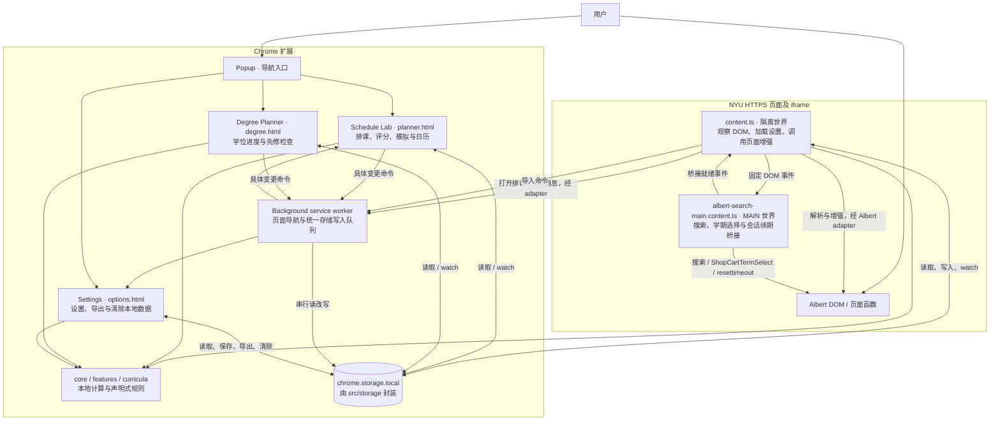
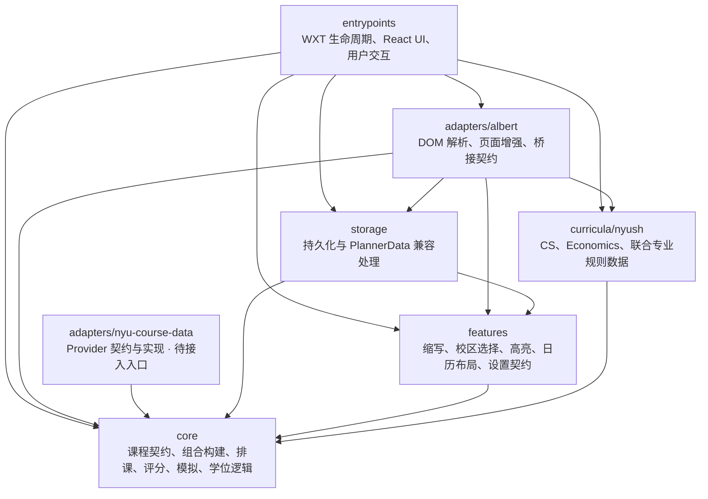
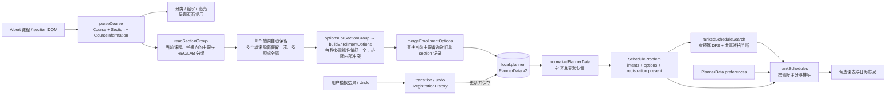

# Albert Enhancer 架构

本文件是项目架构入口，描述当前源码中的职责、依赖和运行流程。图使用可随代码维护的 Mermaid；除明确标为「待接入」或「建议」的内容外，均对应现有实现。

阅读顺序：本文件 → 相关模块 README → 公共接口 → 对应测试。排课组合规则见 [Schedule architecture](SCHEDULE_ARCHITECTURE.md)，权限和数据政策见 [Privacy](PRIVACY.md)。

## 1. 系统与运行边界

项目使用 TypeScript、WXT 和 React，构建为 Chrome Manifest V3 扩展。当前没有自建后端；计算在内容脚本或扩展页面中完成，后台负责打开页面及串行化排课、学位计划和清除数据的变更。

以下箭头表示运行时交互，允许请求、响应和存储通知形成回路，**不代表代码导入关系**。

- 两个内容脚本均匹配 `https://*.nyu.edu/*`，启用 `allFrames`。匹配范围比 Albert 页面广；具体增强由选择器和页面内容判断。
- `content.ts` 监听 DOM 变化和设置、排课存储变化；增强前检查 WXT context，失效后断开 observer、取消存储订阅并移除注入界面，异步初始化也在每次读取后检查有效性。Schedule Lab 与 Degree Planner 先订阅再读取最新值，后续通过 watch 同步跨页面更新；操作只发送具体变更，不能写回页面快照。失效清理还会 abort 搜索与 adapter 搜索监听器、移除归属标记并恢复课程标题。
- MAIN 世界脚本调用 Albert 的 `submitAction_win0` 搜索函数、`IS.SSS.ShopCartTermSelect` 学期函数，以及经过 URL 校验的会话续期流程。学期切换同时按页面原生顺序调用 `makeTablesResponsivePostLoad` 和 `DisplayToggleButton`；函数未就绪或学期元数据不一致时不确认请求。它不读取扩展存储。内容脚本不得通过 `.click()` 执行页面的 `javascript:` 链接。
- 排课状态中的 `got-it`、`full`、`waitlisted` 是本地模拟事件，不向 Albert 提交注册操作。
- Albert 首页在原生学期容器内部、标签之前显示靠右的 Schedule Lab、Degree Planner 和 Settings，不显示 Albert Enhancer 文字。三个按钮和扩展 Popup 共用 `styles/navigationButtons.css` 的紫底白字样式，圆角统一为 3px；这份样式只负责导航按钮外观，由两个宿主的 CSS 引入，宿主各自负责位置和排列。真实页面 `NYU_MAIN_2.css` 对学期区域按钮的颜色、边框、高度等使用 `!important`；共享样式以扩展专用选择器和相同优先级覆盖这些属性，保留原生按钮外观。真实规则的最小回归样本见 `tests/fixtures/albert/homepage-button-overrides.css`，验证见 `tests/features/navigationButtons.test.ts`。首页容器继承 Albert 的原生边距和宽度，避免在外部插入导致错位。`homeToolbar.ts` 负责 DOM、去重及回调；`enhancePage` 通过 runtime 消息打开页面，清理复用内容脚本生命周期。

## 2. 模块依赖与职责

以下箭头统一表示 **A 导入 B**，包含类型依赖；省略模块内部连线和外部库。`core` 的细粒度依赖见 [core README](../src/core/README.md)。

| 模块 / 入口 | 责任与公共接口 | 直接依赖及验证位置 |
| --- | --- | --- |
| `entrypoints/` | `content.ts` 编排注入；MAIN 脚本桥接；`background.ts` 导航；`popup/`、`options/`、`planner/`、`degree/` 提供界面 | 上图中的应用模块、WXT、React；`tests/e2e/extension.spec.ts` |
| `adapters/albert/` | `parseCourse`、`enhanceAlbertPage`、校区/学期适配、脱敏 fixture、续期与事件常量；详见 [模块说明](../src/adapters/albert/README.md) | core、features、curricula、storage；`tests/adapters/`、E2E |
| `adapters/nyu-course-data/` | `CourseDataProvider`：`searchCourses`、`getCourse`、`getEnrollmentOptions`；`NYUCourseDataProvider` 注入 `NYUDataTransport`，解码外部数据；Mock 用于测试 | core 课程契约；`tests/adapters/courseDataProvider.test.ts` |
| `core/` | 平台无关领域契约与纯计算；按 courses、schedule、registration、curriculum 分区；详见 [模块说明](../src/core/README.md) | 仅 core 内部；`tests/courses/`、`schedule/`、`registration/`、`curriculum/` |
| `features/` | `expandAbbreviations` / `resolveAbbreviationQuery`、`selectPreferredCampus`、`buildHighlights`、日历布局及 `AlbertEnhancerSettings` 默认值 | core 类型、features 内部设置契约；`tests/features/` |
| `curricula/nyush/` | 声明式学位要求、分类数据、CS 先修规则；联合专业组合 CS 与 Economics 数据 | core/curriculum 契约、同层专业数据；`tests/curriculum/` |
| `storage/` | 四个存储 item、变更命令和后台统一写入队列；`normalizePlannerData`、`removeCourseFromPlanner`；`exportLocalData`、`deleteAllLocalData` | WXT storage、core、features；`tests/storage/planner.test.ts`、E2E |

有 `index.ts` 的模块以它作为公共入口；`storage` 按领域文件暴露接口。Albert 的 `searchBridge.ts` 是显式共享契约，MAIN 世界另直接导入 `sessionKeeper.ts` 的校验函数。不要通过总出口引入不需要的宿主依赖。

### 依赖约束

1. core 不得依赖 DOM、浏览器 API、React、WXT、adapters、features、storage 或 entrypoints。
2. features 和 curricula 不得反向依赖它们的宿主 adapter、UI 或 storage；storage 不得依赖使用它的 adapter 或 entrypoint。
3. Albert 选择器、页面解析与增强归 `adapters/albert`；entrypoints 只承担宿主生命周期与桥接调用。当前 MAIN 脚本保留少量页面函数访问，属于现存边界例外。
4. 文件导入必须无环；新增跨模块依赖也必须检查模块层面的方向，不能仅以「没有运行时循环」为依据。
5. `EnrollmentOption` 是 solver 的原子选择；讲座、习题课与实验课之间的组合规则由 builder 负责，不能渗入 solver。

顶层模块及 core 分区依赖保持单向：`courses/meetings.ts` 拥有 meeting 冲突原语，builder 与 schedule 均向下依赖 courses。schedule 保留原冲突函数导出以兼容调用方。

## 3. 排课数据流

以下箭头表示数据转换，不表示导入方向。Albert 的关联课程导入已接入 builder；Provider 仍未连接入口。

关键契约：

- `Section` 是真实课程组件；`EnrollmentOption` 是一门课的一套完整可选组合，包含 `sectionIds`、合并后的会议和可选展示元数据。
- builder 对未知多组件兼容关系返回空集合。Albert adapter 根据已核对的按主课排列的 section 块构造显式关联规则：必须读取 `Component:`，同课程同学期内只收集主课后、下一已识别主课前的 recitation/lab。未知或缺失组件元数据使整个分组导入失败。筛选器可能隐藏组件时要求先清除；不能按老师、上课时间或是否有 Select Class 按钮判断类型。此布局约定及来源限制见 [Albert README](../src/adapters/albert/README.md)。
- 一个辅课自动随主课加入；多项默认全选，用户至少保留每种组件的一项。每个保留组合独立存为 option，最终课表每门课只用一个组合。linked recitation/lab 不提供独立 Add 按钮。
- `CourseIntent` 表达课程是否必选、可选 option 范围、section 要求/排除/偏好。精确 option 锁定与 section 锁定语义不同。
- `RegistrationHistory` 包含 `present` 和 `past`。状态转换和撤销都产生新值；solver 只接收 `present`。
- 可行性由 solver 决定，偏好由 ranking 决定；评分不改变可行性。`solveSchedules` 保留穷举 API 供小规模计算和测试；生产入口使用 `rankedScheduleSearch`，默认最多 2,000 个候选或 20,000 步，边评分边只保留前八项。`features/planner/scheduleSearch.ts` 每约 8 ms 让出事件循环，接受 AbortSignal 取消旧任务。Schedule Lab 达到预算时展示 `count+` 和结果不完整提示，不保证全局最优；尚未完成搜索时不得显示已证明无解。content 也异步计算同一预算的预览，每份 planner 状态只计算一次，关闭冲突高亮时不启动，adapter 接收计算结果并排除同课程 option。`bruteForceSchedules` 仅用于性质测试对照。solver 与 robustness 共用 `schedule/eligibility.ts`，包括 option 允许列表、精确锁定及 section 约束。

学位规划是另一条独立流程：`DegreePlanEntry[]` + 所选 `curricula/nyush` 数据 → `evaluateCurriculum` / `dependencyWarnings` → 学位覆盖情况与先修提示 → `local:degree-plan`。目前它与排课数据没有自动同步。

课表外观由 `features/planner/calendarAppearance.ts` 提供纯函数：`calendarCourseTitle` 显示课程名称，移除已存 `Course.title` 开头重复的对应 `Course.code`，兼容旧导入数据；缺少课程记录时回退到 course ID。方块只显示名称和组件，不显示时间行或地点；时间轴、方块的位置与高度、左侧课程列表及下方组件时间摘要保留，不修改已存课程、时间或地点数据。颜色按完整已存课程列表的顺序分配不同色相，以 course ID 复用到同门课的所有组件；切换候选计划不重新配色。颜色不写入存储，也没有自定义设置。组件标签统一使用小写缩写（lecture 为 `lec`、recitation 为 `reci`）；缺少班次显示信息时保留原 section ID。时间定位由 `calendarLayout.ts` 负责。若当前候选包含周六或周日，则动态添加对应日期列；重新导入现有课程保持课程顺序和颜色稳定。验证见 `tests/features/calendarAppearance.test.ts` 和 `tests/e2e/extension.spec.ts`。

## 4. 本地状态与平台接口

| 存储键 | 所有者 / 契约 | 当前读写方 |
| --- | --- | --- |
| `local:settings` | `storage/settings.ts` / `AlbertEnhancerSettings` | Settings 保存；content 读取并 watch |
| `local:planner` | `storage/planner.ts` / `PlannerData` v2 | 后台统一写入；Albert / Schedule Lab 发变更命令；content 与 Schedule Lab 读取和 watch |
| `local:campus-options` | `storage/campuses.ts` / `CampusOption[]` | content 学习并保存；Settings 启动读取 |
| `local:degree-plan` | `storage/degreePlan.ts` / `DegreePlanEntry[]` | 后台统一写入；Degree Planner 发变更命令，读取和 watch |

`PlannerData.term` 在 schema v2 中新增可选字段；归一化旧记录为 `null`（学期未知），保留全部课程、ID 和历史。每份计划只允许一个明确学期，课程和班次 ID 在该计划内唯一；导入必须有明确来源学期，保存端拒绝与非空计划学期不同或未知的导入，绝不自动覆盖或推断旧学期。需要换学期时先按需导出并移除当前课程；空计划可以绑定新学期。

`PlannerData` 的纯数据兼容与删除逻辑位于 `storage/plannerData.ts`，不导入 WXT；`planner.ts` 负责持久化绑定。兼容处理保留旧 option ID，补齐 section 状态、intent 和偏好默认值。

`exportLocalData` 聚合四个 item。`storage/commands.ts` 是页面/adapter 的更新接口，`mutations.ts` 是纯数据变更契约，background 唯一实例化 `createStorageWriter` 串行队列；每条命令读取最新值、应用变更、保存后答复成功或错误。`deleteAllLocalData` 同样进入队列，避免与排课/学位保存交错复活旧快照。页面通过 storage watch 更新，错误显示给用户。`mergeEnrollmentOptions` 仍以主课为更新范围并清理过期状态。Chrome storage 本身没有事务；此保证适用于所有遵循命令协议的生产写入，直接外部改写 storage 不在协议内。详见 [storage README](../src/storage/README.md)。

平台接口只有三类：

- 浏览器 runtime 消息：`update-planner`、`update-degree`、`clear-local-data` 由后台校验扩展 sender 并串行处理；`open-schedule-lab`、`open-degree-planner`、`open-settings`：由 background 打开固定扩展页面；Popup 直接打开页面。
- Albert DOM 事件：固定搜索/续期请求与 bridge-ready 通知，具体契约见 [Albert README](../src/adapters/albert/README.md)。这些事件不能视作可信来源或授权凭证。
- WXT storage 对 `chrome.storage.local` 的封装。后台只执行持久化数据变更，不运行排课搜索，也没有后台排课服务。

权限配置以 `wxt.config.ts` 为准：`storage` 和 NYU HTTPS 主机访问；不加载远程代码，不提交 Enroll、Drop、Swap、Waitlist 操作。会话续期默认关闭，只处理匹配的到期提示与经校验的 NYU HTTPS `cmd=resettimeout` URL。

## 5. 现存边界问题与后续方向

以下为当前剩余边界问题；已实现部分以本文数据流和模块说明为准。

| 观察 | 影响 | 建议的最小后续变更 |
| --- | --- | --- |
| `adapters/albert/enhancePage.ts` 仍同时处理 DOM 与导航消息 | adapter 边界仍略宽；设置已通过每个 root 的显式上下文传递，排课计算已移至 content | 仅在相关导航功能变更时进一步注入回调，避免无关重构 |
| Provider 没有入口调用，状态检测器仅有测试调用 | 外部数据及注册状态仍未端到端接入 | 接入前确定可靠的数据来源；Albert 已通过独立分组 adapter 接入 builder |
| 学期来源读取只接受明确标签，未识别布局会拒绝导入 | 不会猜测学期，但需要补充真实 Albert 布局样本 | 按已核对 DOM 扩展 `offeringTerm.ts`，继续对歧义拒绝导入 |

## 6. 验证与文档维护

- `npm run lint`：包含 core 禁止上层/平台导入规则；`npm run typecheck`：验证 TypeScript 契约。
- `npm test`：运行领域、adapter、feature、存储与架构测试；solver 性质测试对照穷举结果，builder 性质测试检查组合约束。
- `tests/architecture/core-boundary.test.ts` 检查 core 平台词汇边界；`release-audit.test.ts` 检查权限、远程代码模式及排课性能。`dependencies.test.ts` 检查所有本地 import/export（包括 type）的文件环与顶层模块依赖方向。
- `npm run test:e2e`：构建并在 Chromium 中验证扩展页面和 Albert fixture 流程。真实页面验证参见 [Manual checkpoint](MANUAL_CHECKPOINT_1.md)。
- 不允许启动本地测试浏览器时，可用 ChatGPT 内置浏览器打开学期桥接回放页，验证 DOM 调用与手动选择行为；操作及验证边界见 [内置浏览器检查](../tests/browser/README.md)。

新增模块、存储键、跨世界事件或数据通路时，同步更新本文件与模块 README；修改组件组合契约时，同时更新 [Schedule architecture](SCHEDULE_ARCHITECTURE.md) 和相关测试。
