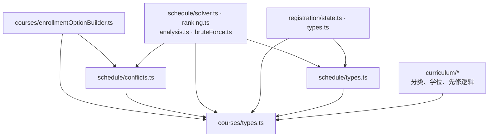

# Core：平台无关的领域逻辑

架构入口：[docs/architecture.md](../../docs/architecture.md)。本目录只负责契约与纯计算，不访问 DOM、扩展存储、React 或浏览器 API。

## 公共接口与所有权

| 分区 | 主要接口 | 责任 |
| --- | --- | --- |
| `courses/` | `Course`、`Section`、`Meeting`、`RawCourseOffering`、`EnrollmentOption`；`buildEnrollmentOptions` | 课程契约与合法组件组合构建 |
| `schedule/` | `ScheduleProblem`、`CourseIntent`、`RegistrationState`；`solveSchedules`、`rankSchedules`、`analyzeCourseConflict`、冲突函数 | 可行课表搜索、偏好排序与冲突分析；`bruteForceSchedules` 用于测试对照 |
| `registration/` | `RegistrationEvent`、`RegistrationHistory`；`applyRegistrationEvent`、`transition`、`undo` | 本地模拟状态和撤销历史，不执行外部注册 |
| `curriculum/` | `Curriculum`、`DegreePlanEntry`、先修契约；`classifyCourse`、`evaluateCurriculum`、`evaluatePrerequisites`、`dependencyWarnings` | 分类、学位覆盖和先修检查，接受外部声明式专业规则 |

各分区 `index.ts` 为公共入口；根 `index.ts` 聚合导出。分区内部优先直接引用契约文件，避免经过总出口间接引入自身。

## 当前内部依赖

箭头表示导入，包含类型导入。图拆开课程契约与构建器，以准确显示文件图无环的原因；**不能由此推断 courses 与 schedule 两个目录之间不存在双向依赖**。

图省略同一节点内部与 barrel 的连线。`RegistrationState` 当前归 `schedule/types.ts` 所有，registration 实现依赖该契约；schedule 不依赖 registration 实现。curricula 数据由调用方传入，core 不导入 `src/curricula`。

## 关键不变量

- Meeting 时间使用当天分钟数，区间为 `[startMinute, endMinute)`；相接但不重叠的课程不冲突。
- 一个 option 属于一门课程；多组件组合必须先验证 cardinality、兼容关系和内部时间冲突。多组件兼容关系未知时，builder 不生成结果。
- solver 每门已选课程至多选择一个 option，按约束和冲突判断可行性；它不了解 lecture/recitation 组合规则。
- option 的精确锁定不等于 section 锁定；section 要求可以保留多个合法 option。
- ranking 只改变顺序；用户偏好不改变 solver 的可行性规则。
- registration 转换返回新状态，历史由 `past` / `present` 显式表达；存储和 UI 更新由调用方负责。
- 专业政策存在歧义时保留人工确认提示，不能自行推断满足条件。

当前 Albert 添加流程尚未调用 builder；完整组合管线与接入差距见 [Schedule architecture](../../docs/SCHEDULE_ARCHITECTURE.md)。

## 测试与变更入口

课程组合修改查看 `tests/courses/`；搜索、冲突和评分修改查看 `tests/schedule/`；模拟行为查看 `tests/registration/`；学位逻辑查看 `tests/curriculum/`。平台边界由 ESLint 与 `tests/architecture/core-boundary.test.ts` 检查。

修改公共契约时，连同 adapter、存储兼容逻辑及现有调用方验证。共享冲突原语的目录所有权问题记录在架构入口中，未经实现不能将目录依赖标为已完全单向。
